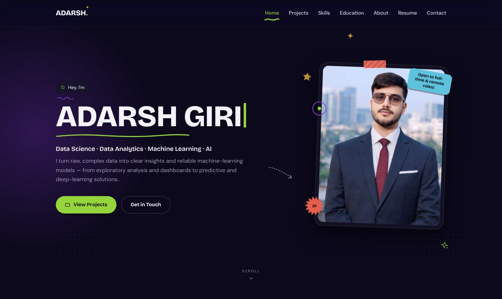
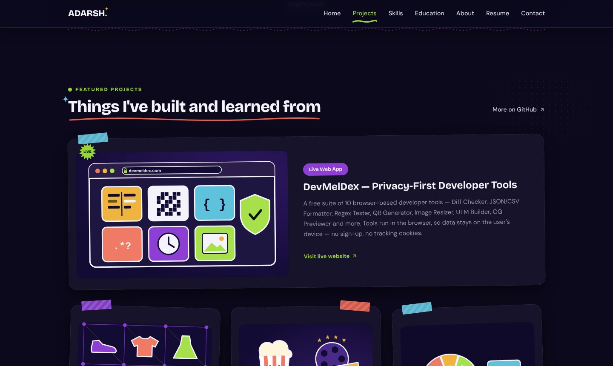
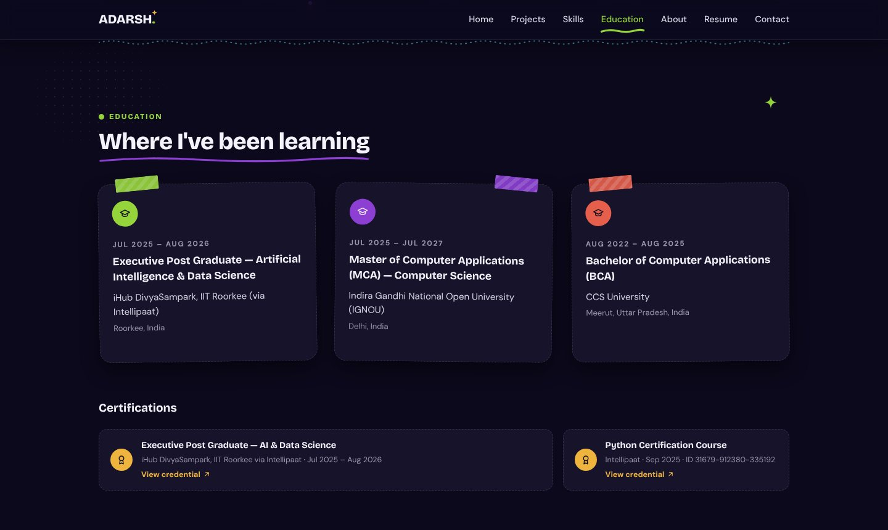
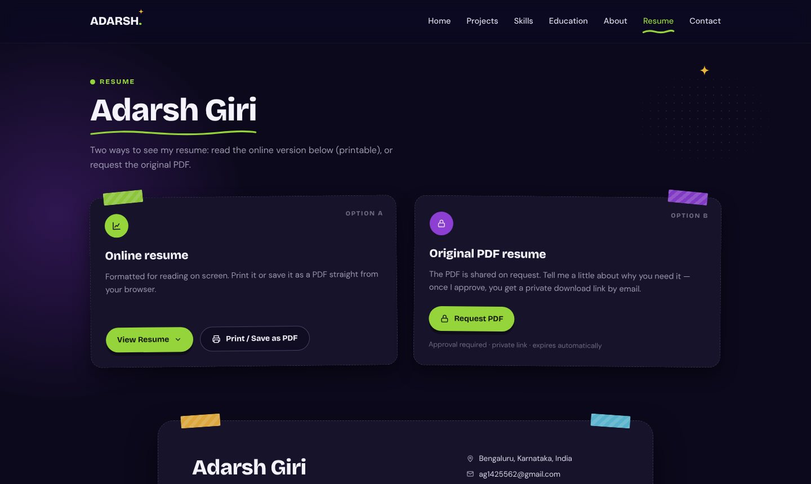
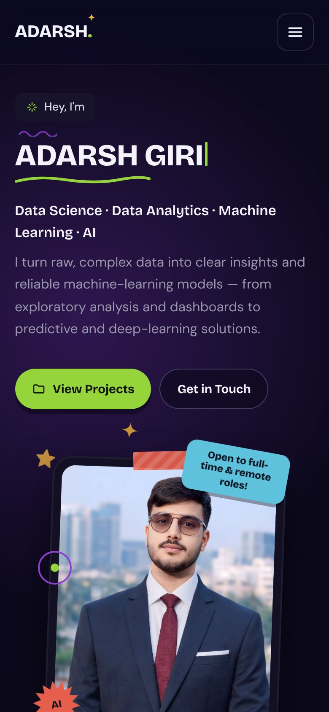
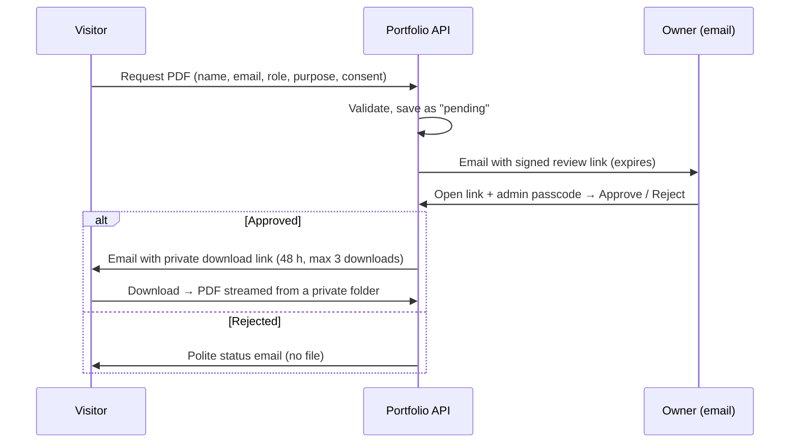

<div align="center">

# Adarsh Giri — Portfolio

**Data Science · Data Analytics · Machine Learning · AI**

A hand-crafted, animated personal portfolio with a working contact form and an
approval-gated resume download, built with vanilla JavaScript, Vite and a small Node.js API.

<!-- Replace with your live URL once deployed -->
[**🌐 Live site**](#-deployment) &nbsp;·&nbsp;
[**💼 LinkedIn**](https://www.linkedin.com/in/adarsh-giri-252b60293) &nbsp;·&nbsp;
[**🐙 GitHub**](https://github.com/adarsh8601) &nbsp;·&nbsp;
[**🧰 DevMelDex**](https://devmeldex.com)


<br/>



</div>

---

## ✨ Highlights

| | |
|---|---|
| ⌨️ **Typewriter hero** | The name types itself letter by letter, pauses, erases and re-types — with no layout shift. |
| 🪟 **Glass navbar** | Fixed, translucent, blurred navigation that firms up as you scroll — on every device. |
| 🧠 **Interactive neural network** | A lightweight canvas visualisation you can drag to rotate (no 3D library). |
| 🎞️ **Tasteful motion** | Floating, pointer-tilting portrait, scroll-reveal cards, hover effects — all paused off-screen and disabled for `prefers-reduced-motion`. |
| 📬 **Real contact form** | Validated on both client and server, optional attachment (type + magic-byte checked), honeypot + rate limiting, delivered by email. |
| 🔐 **Approval-gated resume** | Visitors *request* the PDF; the owner approves via a signed link + passcode; the visitor receives a short-lived, download-limited link. |
| 🖨️ **Online resume** | A printable HTML resume page with a clean “Save as PDF” print layout. |
| 📱 **Fully responsive** | Audited from 320 px phones to desktop — no horizontal scroll, nothing clipped. |

## 📸 Screenshots

<div align="center">




</div>

## 🗂️ What's inside

- **Home** — hero, neural-network visual, featured projects (incl. the live web app **DevMelDex**), toolkit, education & verified certifications, about, contact.
- **Resume** (`/resume/`) — Option A: online, printable resume. Option B: request the original PDF.

### Featured projects

| Project | Area | Link |
|---|---|---|
| **DevMelDex** — privacy-first developer tools | Live web app | [devmeldex.com](https://devmeldex.com) |
| Credit Score Classification — Financial Risk ML Pipeline | Financial risk ML | [repo](https://github.com/adarsh8601/Credit-Score-Project) |
| Breast Cancer Detection using ANN | Healthcare ML | [repo](https://github.com/adarsh8601/Breast-Cancer-Detection-using-ANN) |
| Trader Behavior vs Market Sentiment Analysis | Data analysis | [repo](https://github.com/adarsh8601/trader-behavior-market-sentiment) |
| Restaurant Revenue Prediction | Regression | [repo](https://github.com/adarsh8601/Restaurant-Revenue-Predication) |
| Fashion-MNIST Image Classification using ANN | Deep learning | [profile](https://github.com/adarsh8601) |
| Netflix Movie Recommendation System | Recommender system | [profile](https://github.com/adarsh8601) |

## 🛠️ Tech stack

| Layer | Tools |
|---|---|
| Frontend | Vanilla JS (ES modules), hand-written CSS with design tokens, Canvas 2D, Vite (multi-page build) |
| Fonts | Bricolage Grotesque, DM Sans (self-hosted via Fontsource) |
| API | Node.js + [Hono](https://hono.dev), Nodemailer (SMTP) or Resend |
| Security | HMAC-signed expiring tokens, passcode-protected approval, rate limiting, upload sniffing, strict headers |
| Quality | ESLint, Node's built-in test runner, Playwright (manual E2E checks) |

## 🔐 How the resume approval works



The PDF never lives in `public/`; tokens are purpose-bound (a review link can't download, a download link can't approve), and pending, rejected, expired or over-limit links are refused.

## 🚀 Getting started

**Requirements:** Node.js **20.12+**

```bash
git clone https://github.com/adarsh8601/<this-repo>.git
cd <this-repo>
npm install
cp .env.example .env        # Windows PowerShell: Copy-Item .env.example .env
npm run dev                 # site → http://localhost:5173 · API → http://localhost:8787
```

Put your resume at `server/private/resume.pdf` (this folder is git-ignored).

### Scripts

| Command | What it does |
|---|---|
| `npm run dev` | Vite dev server + API with auto-reload |
| `npm run build` | Production build into `dist/` |
| `npm start` | Serve `dist/` + API in production mode (`NODE_ENV=production`) |
| `npm run lint` | ESLint |
| `npm test` | API, workflow & Vercel-entry tests (27) |
| `npm run upload-resume` | Upload the private PDF to Upstash (for Vercel) |
| `npm run check` | Lint + tests + build |

## ⚙️ Configuration

All personal content lives in **`src/data/content.js`** — name, headline, links, projects, skills, education, certifications, about text and resume content. Colours, type scale and spacing live in **`src/styles/tokens.css`**.

Server settings and secrets live in **`.env`** (local) or your host's **environment variables** (production) — never in the code:

| Variable | Purpose |
|---|---|
| `PUBLIC_SITE_URL` | Public `https://` address of the site, used to build links in emails (e.g. `https://your-site.vercel.app`). Localhost is refused in production; on Vercel it defaults to the project's production domain |
| `TOKEN_SECRET` | ≥ 32 random characters — signs review / download links |
| `ADMIN_PASSCODE` | ≥ 12 characters — required to approve or reject |
| `NOTIFY_EMAIL` | Private inbox for contact messages and resume requests |
| `MAIL_PROVIDER` | `smtp` or `resend` (`console` = local only, prints instead of sending) |
| `MAIL_FROM` | Sender address |
| `SMTP_HOST` · `SMTP_PORT` · `SMTP_SECURE` · `SMTP_USER` · `SMTP_PASS` | SMTP settings (e.g. Gmail + App Password) |
| `RESEND_API_KEY` | When using Resend |
| `UPSTASH_REDIS_REST_URL` · `UPSTASH_REDIS_REST_TOKEN` | Storage for requests + private PDF on Vercel |
| `RESUME_PDF_PATH` · `DATA_DIR` | Private PDF location and request storage |
| `REVIEW_LINK_TTL_HOURS` · `DOWNLOAD_LINK_TTL_HOURS` · `MAX_DOWNLOADS` · `RETENTION_DAYS` | Workflow limits |

See [`.env.example`](.env.example) for every option with comments. `GET /api/health` shows which features are ready and names any missing variables (never their values). In production the server refuses to start if a secret is missing or weak.

## 📁 Project structure

```
├── index.html, resume/index.html   # pages (Vite multi-page)
├── src/
│   ├── data/content.js             # ← all editable content
│   ├── components/                 # header, hero, projects, skills, education, about, contact, resume…
│   ├── lib/                        # motion, forms, decorative SVG helpers
│   └── styles/                     # tokens, base, sections, motion, forms, resume (+ print)
├── shared/validation.js            # rules shared by browser and server
├── api/index.js                    # Vercel Function entry (wraps the same API)
├── server/                         # Hono API: contact, resume request / review / download
│   └── private/                    # resume.pdf goes here (git-ignored)
├── public/assets/                  # portrait and project illustrations
├── tests/                          # node:test suite
└── docs/                           # README screenshots
```

## 🌍 Deployment (Vercel + Upstash, free)

The site is static; the API runs as a **Vercel Function** (`api/index.js`, see `vercel.json`) and stores resume requests and the private PDF in **Upstash Redis** (free tier) because Vercel has no persistent disk.

1. Create a free Redis database on [Upstash](https://console.upstash.com) and copy its **REST URL** and **REST token**.
2. Put them in your local `.env` as `UPSTASH_REDIS_REST_URL` / `UPSTASH_REDIS_REST_TOKEN`, then upload the PDF once:
   ```bash
   npm run upload-resume
   ```
3. On [Vercel](https://vercel.com/new) import this repository (framework: Vite — settings come from `vercel.json`).
4. In **Settings → Environment Variables** add `PUBLIC_SITE_URL` (your `*.vercel.app` URL), `TOKEN_SECRET`, `ADMIN_PASSCODE`, `NOTIFY_EMAIL`, `MAIL_PROVIDER=smtp`, `MAIL_FROM`, `SMTP_HOST`, `SMTP_PORT=465`, `SMTP_SECURE=true`, `SMTP_USER`, `SMTP_PASS`, `UPSTASH_REDIS_REST_URL`, `UPSTASH_REDIS_REST_TOKEN` — then **Redeploy**.

Static-only hosts (GitHub Pages, plain Netlify) can show the site but **cannot** run the forms. Any host with a long-running Node process and a persistent disk can also use `npm run build && npm start`. Never commit `.env` or `server/private/resume.pdf`.

## 🔒 Security & privacy

- Secrets are read only from environment variables — none are bundled into the browser build.
- Visitor data is used only to process a request and is deleted after `RETENTION_DAYS` (default 90).
- All visitor input is HTML-escaped in emails and on the review page.
- Uploads: allow-listed extensions, 4 MB limit, content (magic-byte) verification.

## 👤 Author

**Adarsh Giri** — Data Science trainee · Executive PG in AI & Data Science, IIT Roorkee (iHub DivyaSampark) · MCA, IGNOU · Bengaluru, India

[LinkedIn](https://www.linkedin.com/in/adarsh-giri-252b60293) · [GitHub](https://github.com/adarsh8601) · [DevMelDex](https://devmeldex.com)

<div align="center"><sub>© 2026 Adarsh Giri. All rights reserved.</sub></div>
